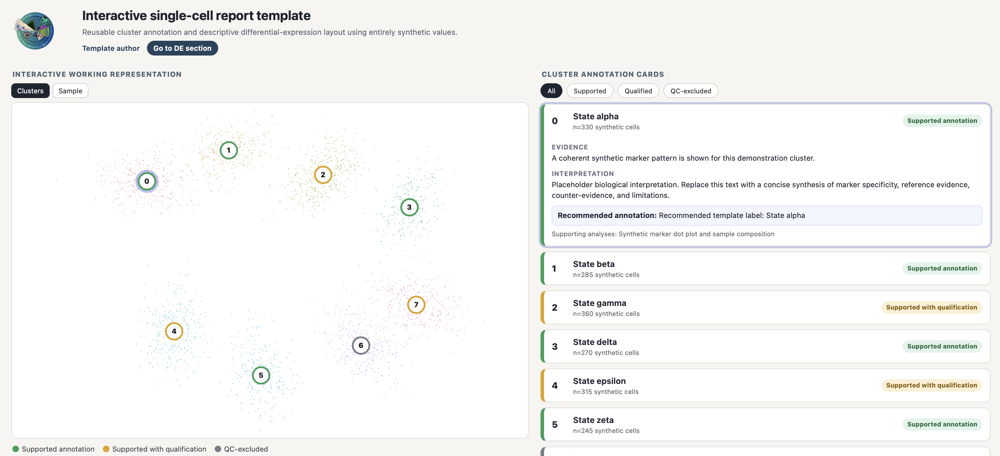
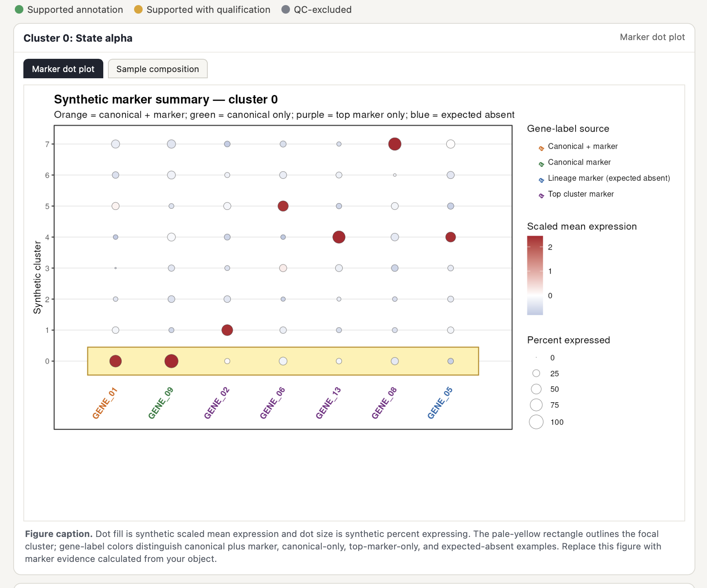
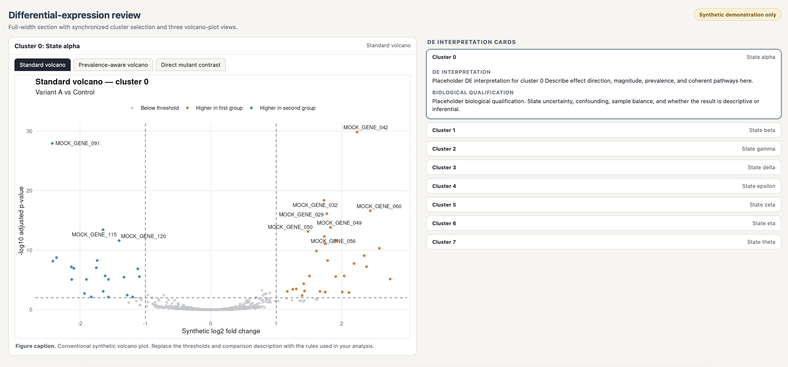

# Interactive cluster-review report template

This directory is a reusable, self-contained Quarto template modeled on the two-panel cluster-review and full-width differential-expression layout developed for NIAID-1263. It contains no biological measurements, gene-expression values, annotations, or DE results from that project. The bundled cell coordinates, metadata, marker summaries, and DE statistics are deterministic synthetic examples.

The header uses the RTB_wheel logo stored under `assets/`; branding can be replaced independently of the analytical example data.

## Preview

### Interactive cluster annotation



### Supporting evidence and differential-expression review

| Marker-evidence panel | Differential-expression review |
|:--:|:--:|
|  |  |

## Render

From this directory:

```bash
quarto render report_template.qmd
```

The render executes `scripts/generate_mock_data.R`, recreates all files under `data/` and `figures/`, and writes `report_template.html`. The HTML embeds its CSS, JavaScript, and figures and can be opened as one portable file.

## Reuse

1. Replace `scripts/generate_mock_data.R` with a project-specific preparation script or modify it to read your analysis outputs.
2. Preserve the output schemas documented in `data/README.md` and `figures/README.md`.
3. Edit cluster text in the `cluster_records` block in `report_template.qmd`, or replace that block with YAML/JSON input.
4. Adjust titles, colors, callout text, and DE thresholds without changing the HTML/JavaScript layout.

The top-left UMAP is a tabset with cluster-colored and sample-colored views. Circular UMAP labels are HTML buttons positioned from cluster-centroid coordinates on the Clusters tab; the Sample tab instead contains light final-cluster labels for orientation. Selecting a circle or cluster card synchronizes the right-side card and the supporting-figure panel. The lower DE section has independent cluster selection and tabs for standard, prevalence-aware, and direct-contrast volcano plots.

## Inline customization guide

`report_template.qmd` begins with a non-rendered maintainer guide and includes comments beside each extension point. It documents the data contract, hotspot-coordinate convention, adding cluster-specific or shared supporting figures, adding DE tabs, adding clusters and callouts, editing captions, and the division of responsibilities among the QMD, `styles.css`, and `interactions.js`.
