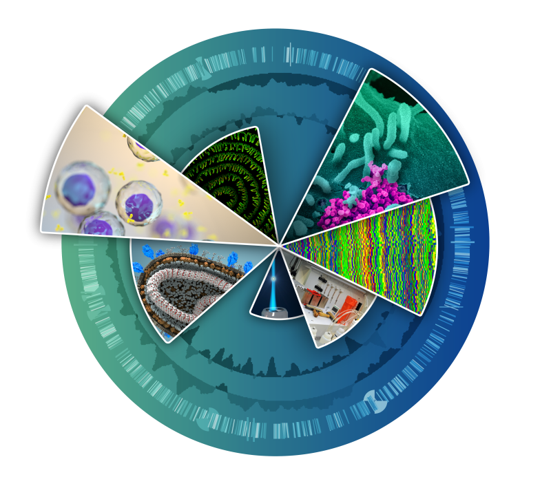

<!--
===============================================================================
TEMPLATE MAINTAINER GUIDE (this comment is not shown in the rendered report)
===============================================================================

QUICK START
1. Work from the directory containing this QMD so all relative paths resolve.
2. Run `quarto render report_template.qmd`.
3. The synthetic example currently rebuilds its inputs by sourcing
   `scripts/generate_mock_data.R`. For a real project, replace that source call
   with your preparation script, or read your already prepared data/plot files.
4. Keep `embed-resources: true` if you want one portable HTML containing its
   CSS, JavaScript, and images.

DATA CONTRACT
- One row per cluster is required in `cluster_records`.
- Required fields are: id, label, status, evidence, assessment, and suggestion.
- `status` must be `agree`, `minor`, or `excl` unless you also update the status
  labels in `interactions.js` and their colors in `styles.css`.
- `cluster_hotspots.csv` supplies `cluster`, `cells`, `pos_x`, and `pos_y`.
  `pos_x` and `pos_y` are fractions from 0 to 1 across the exact displayed UMAP
  image. The Y coordinate is measured from the top. Recalculate these positions
  whenever the UMAP image limits, aspect ratio, or cropping changes.

HOW TO ADD A TOP-LEFT UMAP TAB
- Add an entry to the `umaps` list in the payload. Each entry needs a displayed
  `title`, an image `uri`, and `interactive_clusters = TRUE` or `FALSE`.
- Use `TRUE` only when the image uses the exact limits behind the hotspot
  coordinates. For other annotations, use `FALSE` and draw light final-cluster
  labels into the plot itself so readers retain spatial orientation.
- The tab buttons and image switching are generated by `interactions.js`.

HOW TO ADD A SUPPORTING FIGURE TAB UNDER THE UMAP
1. Create one image per cluster, preferably with a predictable name such as
   `figures/cluster_00_new_analysis.png`.
2. In `make_supporting_figures()`, add another `list(...)` entry:

     list(
       title = "New analysis",
       uri = image_uri(sprintf("figures/cluster_%02d_new_analysis.png", id)),
       caption = "Explain what is plotted, how it was calculated, and its limit."
     )

3. No JavaScript edit is needed. `interactions.js` builds the tab button from
   every entry in `figs` and synchronizes it with the selected cluster.
4. If a tab is available only for selected clusters, build the base list first
   and append the optional entry only when `id` is in those clusters.

HOW TO ADD A DE FIGURE TAB
- Add the same three fields plus a unique `key` inside `make_de_figures()`:

     list(
       key = "heatmap",
       title = "Top-gene heatmap",
       uri = image_uri(sprintf("figures/cluster_%02d_heatmap.png", id)),
       caption = "State selection, scaling, comparison, and thresholds."
     )

- The DE tab row is generated automatically from `de_figs`.

HOW TO USE A SINGLE SHARED FIGURE
- Replace the cluster-specific `sprintf(...)` path with a fixed path, for
  example `image_uri("figures/shared_method_diagram.png")`.

HOW TO ADD OR REMOVE CLUSTERS
- Update the cluster IDs in the data-preparation script, `cluster_records`, and
  hotspot table together. Every cluster must have a unique ID and matching plot
  files for every figure constructor called for it.
- The interactive circles, annotation cards, DE cards, filters, counts, and
  default selection are generated from the `clusters` payload automatically.

HOW TO EDIT TEXT AND CALLOUTS
- Cluster-level text is defined in `cluster_records` and in the `clusters` list.
- Collapsible callouts are HTML `<details>` elements in `callouts_html`. Copy an
  entire `<details>...</details>` block to add another one.
- Escape collaborator-supplied free text before inserting it as HTML. The
  `escape_html()` helper is provided for that purpose.

LAYOUT AND INTERACTIVITY
- Edit wording and static page structure in the raw HTML block below.
- The header logo is `assets/RTB_Wheel.png`. Replace that file and update its
  alternative text when applying different project or institutional branding.
- Edit dimensions, colors, spacing, sticky behavior, and responsive rules in
  `styles.css`.
- Edit selection, filtering, tabs, figure zoom, and card creation in
  `interactions.js`.
- Keep element IDs used by JavaScript (`umapbox`, `support-panel`, `cluster-cards`,
  `de-figures`, `de-cards`, `filters`, `summary-box`, and `zoom`) unless the same
  IDs are updated in `interactions.js`.

FIGURE CAPTIONS
- Each figure entry has its own `caption`. Captions should state what aesthetics
  encode, the calculation or threshold used, and the main interpretive limit.

===============================================================================
-->

```{r setup}
suppressPackageStartupMessages({
  library(jsonlite)
  library(knitr)
})

# TEMPLATE USE: Replace this source call with the project-specific data and
# figure preparation step. It must finish before image_uri() reads the images.
# Rebuild deterministic synthetic inputs and figures on every render.
source("scripts/generate_mock_data.R")

escape_html <- function(x) {
  x <- gsub("&", "&amp;", x, fixed = TRUE)
  x <- gsub("<", "&lt;", x, fixed = TRUE)
  x <- gsub(">", "&gt;", x, fixed = TRUE)
  x <- gsub('"', "&quot;", x)
  x
}

# TEMPLATE USE: Hotspot coordinates position the circular cluster buttons over
# the UMAP. Values must correspond to the exact image supplied in payload$umap.
hotspots <- read.csv("data/cluster_hotspots.csv", stringsAsFactors = FALSE)
composition <- read.csv("data/sample_composition.csv", stringsAsFactors = FALSE)

# TEMPLATE USE: This table controls the collaborator-facing cluster cards.
# Replace these placeholders directly or read the same columns from YAML/CSV.
cluster_records <- data.frame(
  id = 0:7,
  label = c(
    "State alpha", "State beta", "State gamma", "State delta",
    "State epsilon", "State zeta", "State eta", "State theta"
  ),
  status = c("agree", "agree", "minor", "agree", "minor", "agree", "excl", "minor"),
  evidence = c(
    "A coherent synthetic marker pattern is shown for this demonstration cluster.",
    "Several invented markers distinguish this cluster in the mock dot plot.",
    "The synthetic evidence supports a broad state, with deliberately uncertain wording.",
    "Mock marker and composition summaries agree with the example label.",
    "The template illustrates how to retain a qualified or transitional annotation.",
    "Invented markers form a clean demonstration signal.",
    "This example shows how a QC-excluded cluster can be styled and filtered.",
    "The example label is intentionally provisional and should be replaced."
  ),
  assessment = paste(
    "Placeholder biological interpretation. Replace this text with a concise synthesis",
    "of marker specificity, reference evidence, counter-evidence, and limitations."
  ),
  suggestion = paste("Recommended template label:", c(
    "State alpha", "State beta", "State gamma-like", "State delta",
    "State epsilon-like", "State zeta", "Exclude from interpretation", "State theta-like"
  )),
  stringsAsFactors = FALSE
)

cluster_records <- merge(cluster_records, hotspots, by.x = "id", by.y = "cluster", sort = FALSE)
cluster_records <- cluster_records[order(cluster_records$id), ]

# TEMPLATE USE: Add a list entry here for every new bottom-left tab. The
# JavaScript creates tabs in list order; no extra HTML is required.
make_supporting_figures <- function(id) {
  list(
    list(
      title = "Marker dot plot",
      uri = image_uri(sprintf("figures/cluster_%02d_marker_dotplot.png", id)),
      caption = paste(
        "Dot fill is synthetic scaled mean expression and dot size is synthetic percent expressing.",
        "The pale-yellow rectangle outlines the focal cluster; gene-label colors distinguish",
        "canonical plus marker, canonical-only, top-marker-only, and expected-absent examples.",
        "Replace this figure with marker evidence calculated from your object."
      )
    ),
    list(
      title = "Sample composition",
      uri = image_uri(sprintf("figures/cluster_%02d_sample_composition.png", id)),
      caption = paste(
        "Synthetic counts and within-cluster proportions for three generic samples.",
        "Cell counts are descriptive and are not biological replicates."
      )
    )
  )
}

# TEMPLATE USE: Add new DE plot types here. `key` should be unique within a
# cluster, while title and caption are shown to the reader.
make_de_figures <- function(id) {
  list(
    list(
      key = "standard", title = "Standard volcano",
      uri = image_uri(sprintf("figures/cluster_%02d_standard_volcano.png", id)),
      caption = paste(
        "Conventional synthetic volcano plot. Replace the thresholds and comparison",
        "description with the rules used in your analysis."
      )
    ),
    list(
      key = "prevalence", title = "Prevalence-aware volcano",
      uri = image_uri(sprintf("figures/cluster_%02d_prevalence_volcano.png", id)),
      caption = paste(
        "Highlighted points additionally pass a detection-fraction difference.",
        "Grey background points remain small and fixed-size."
      )
    ),
    list(
      key = "direct", title = "Direct mutant contrast",
      uri = image_uri(sprintf("figures/cluster_%02d_direct_contrast.png", id)),
      caption = paste(
        "Synthetic direct contrast between two generic variants.",
        "Use this panel for a pairwise comparison or response-concordance view."
      )
    )
  )
}

# TEMPLATE USE: This is the complete object passed to interactions.js. Add
# cluster-specific fields here if new cards or JavaScript views need them.
clusters <- lapply(seq_len(nrow(cluster_records)), function(i) {
  x <- cluster_records[i, ]
  list(
    id = as.character(x$id),
    label = x$label,
    status = x$status,
    cells = unname(x$cells),
    pos_x = unname(x$pos_x),
    pos_y = unname(x$pos_y),
    evidence = x$evidence,
    assessment = x$assessment,
    suggestion = x$suggestion,
    pages = "Synthetic marker dot plot and sample composition",
    figs = make_supporting_figures(x$id),
    de_figs = make_de_figures(x$id),
    de_interpretation = paste(
      "Placeholder DE interpretation for cluster", x$id,
      "Describe effect direction, magnitude, prevalence, and coherent pathways here."
    ),
    biological_qualification = paste(
      "Placeholder biological qualification. State uncertainty, confounding,",
      "sample balance, and whether the result is descriptive or inferential."
    )
  )
})

# TEMPLATE USE: Each <details> block becomes one collapsed callout. Copy a full
# block to add a callout. Apply escape_html() to untrusted/free-form input.
callouts_html <- paste0(
  '<div class="callout-heading">Expandable method and interpretation notes</div>',
  '<details class="callout-box"><summary>Data processing placeholder</summary>',
  '<div class="callout-body"><p>Lorem ipsum dolor sit amet, consectetur adipiscing elit. ',
  'Replace this paragraph with preprocessing, normalization, integration, and clustering details.</p>',
  '<p><b>Example parameters:</b> 3,000 variable features; 30 dimensions; deterministic seed.</p></div></details>',
  '<details class="callout-box"><summary>Annotation evidence placeholder</summary>',
  '<div class="callout-body"><p>Praesent commodo cursus magna. Explain canonical markers, ',
  'reference annotations, counter-programs, and the rule used to assign confidence.</p></div></details>',
  '<details class="callout-box"><summary>Statistical interpretation placeholder</summary>',
  '<div class="callout-body"><p>Donec sed odio dui. Record replicate structure, model assumptions, ',
  'multiple-testing correction, effect-size thresholds, and limits on causal interpretation.</p></div></details>'
)

# TEMPLATE USE: Add report-wide data here when JavaScript needs it. image_uri()
# embeds the figure in the final HTML; use a normal relative URL instead if you
# intentionally want external assets rather than a self-contained report.
payload <- toJSON(list(
  umaps = list(
    list(
      title = "Clusters",
      uri = image_uri("figures/mock_umap.png"),
      interactive_clusters = TRUE
    ),
    list(
      title = "Sample",
      uri = image_uri("figures/mock_umap_by_sample.png"),
      interactive_clusters = FALSE
    )
  ),
  clusters = clusters,
  interpretive_limit = paste(
    "All values in this template are synthetic. Replace this sentence with the",
    "principal experimental-design limitation for the real project."
  ),
  callouts_html = callouts_html
), auto_unbox = TRUE, null = "null", dataframe = "rows")
```

```{=html}
<!--
Static page scaffold. The empty containers are populated by interactions.js.
Preserve referenced IDs or update the corresponding JavaScript selectors.
-->
<header class="report-header">
  
  <div>
    <h1>Interactive single-cell report template</h1>
    <div class="subtitle">Reusable cluster annotation and descriptive differential-expression layout using entirely synthetic values.</div>
    <div class="author-row">
      <span>Template author</span>
      <a href="#de-review-title">Go to DE section</a>
    </div>
  </div>
</header>

<div class="review-grid">
  <section class="left-column">
    <div class="section-kicker">Interactive working representation</div>
    <div class="umap-tabs" id="umap-tabs"></div>
    <div class="umap-box" id="umapbox">
      
    </div>
    <div class="legend">
      <span><i class="legend-dot agree"></i>Supported annotation</span>
      <span><i class="legend-dot minor"></i>Supported with qualification</span>
      <span><i class="legend-dot excl"></i>QC-excluded</span>
    </div>
    <div class="support-panel" id="support-panel"></div>
    <div class="summary-box" id="summary-box"></div>
    <div id="callout-slot"></div>
  </section>

  <aside class="right-column">
    <div class="section-kicker">Cluster annotation cards</div>
    <div class="filters" id="filters"></div>
    <div id="cluster-cards"></div>
  </aside>
</div>

<section class="de-review" id="de-review-title">
  <div class="de-heading">
    <div>
      <h2>Differential-expression review</h2>
      <p>Full-width section with synchronized cluster selection and three volcano-plot views.</p>
    </div>
    <span class="badge">Synthetic demonstration only</span>
  </div>
  <div class="de-grid">
    <div class="de-left" id="de-figures"></div>
    <div class="de-right">
      <div class="section-kicker">DE interpretation cards</div>
      <div id="de-cards"></div>
    </div>
  </div>
</section>

<div class="zoom" id="zoom"></div>
```

```{r payload, results='asis'}
# TEMPLATE USE: Keep this chunk after the HTML containers. It exposes the R
# payload to the browser and then loads the interaction code.
cat('<script>const TEMPLATE_DATA = ', payload, ';</script>', sep = "")
cat('<script>', paste(readLines("interactions.js", warn = FALSE), collapse = "\n"), '</script>', sep = "")
```
